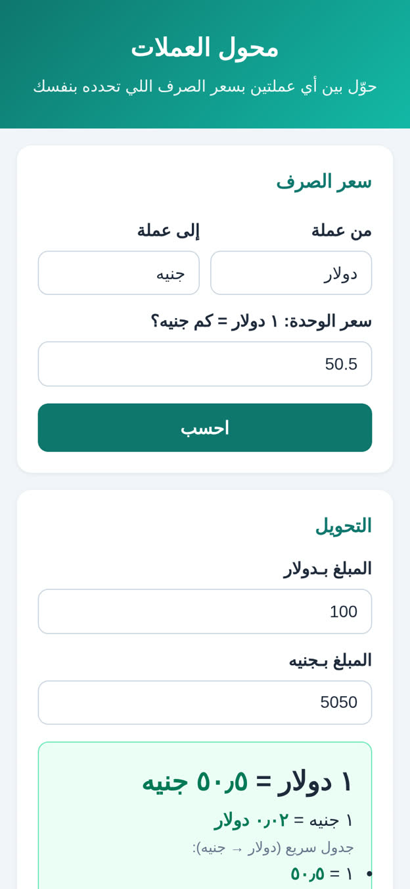

# Currency Converter | محول العملات

Convert between any two currencies using an exchange rate you enter yourself, both directions at once, with a quick-amounts table. Arabic interface.

**Live app:** https://abood-ayman.github.io/currency-converter-ar/

**LinkedIn:** [Project entry](https://www.linkedin.com/in/abdullah-ayman-1678b737b/details/projects/)

This is a personal project, built with AI tools.

## Features
- You enter the exchange rate yourself (from your bank or the market), so the math is transparent
- Converts in both directions at the same time
- Editable currency names (USD/EGP by default)
- Ready-made table for common amounts: 1, 5, 10, 50, 100, 500, 1000

## Note
The tool does not fetch rates from the internet. Rates change constantly - check the current rate from a source you trust before any financial decision.

## Privacy
Everything runs in your browser. No data is stored or sent anywhere.

## Run locally
Open `index.html` in any browser. It is a single static page with no dependencies.

## Status
Stable.

## Copyright
MIT License - Copyright (c) 2026 Abdullah Ayman.
